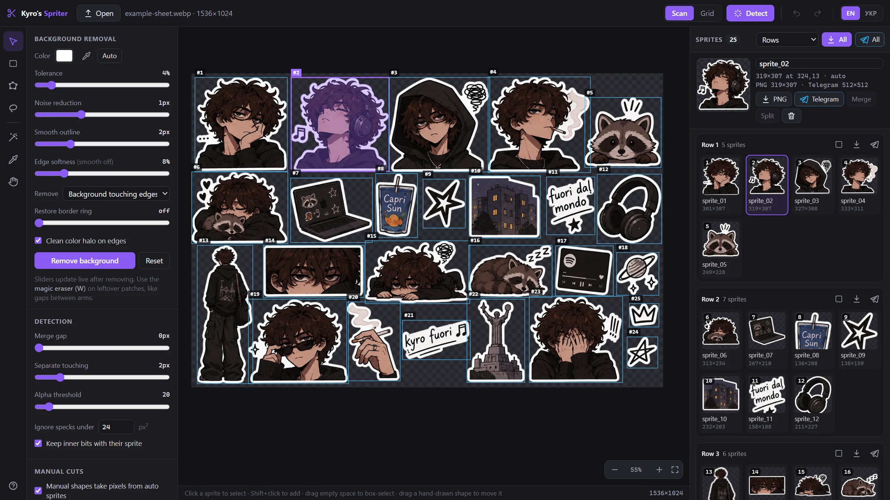

<div align="center">

# Kyro's Spriter

**Cut sprite & sticker sheets into separate images — right in your browser.**

### [▶&nbsp; Open Kyro's Spriter](https://raccoon-hero.github.io/kyro-spriter/)

[Try it with the example sheet](https://raccoon-hero.github.io/kyro-spriter/?example&select=2) · English / Українська · No install, no upload

<a href="https://raccoon-hero.github.io/kyro-spriter/?example&select=2"></a>

</div>

Drop in a sheet (PNG with transparency works best — plain white or colored backgrounds are removed for you),
and every sprite is found, cut out and ready to download one by one, per row, or all at once as a ZIP —
including as **512×512 Telegram stickers**. Everything runs locally in your browser; your images never leave
your computer. Switch the interface between English and Ukrainian with **EN / УКР** in the top bar.

## What it does

- **Scan mode** — finds sprites by transparency. *Merge gap* joins parts that are close together; *Separate touching* splits stickers whose borders touch; *Keep inner bits* keeps small details (sparkles, "...") with the sprite whose box they sit in.
- **Grid mode** — cuts an even grid, by column/row count or by cell size, with offset and spacing.
- **Background removal** — plain backgrounds are detected and removed automatically on load, with the tolerance calibrated from the image's compression noise, so white sticker borders on a near-white background survive. *Noise reduction* and *Smooth outline* give clean, straight borders; use the **magic eraser (W)** on leftover patches, and *Restore border ring* when borders are exactly the background color.
- **Manual cuts** — rectangle (R), polygon (P) or freehand lasso (L) to define any sprite shape. Hold **Shift** while finishing to add to the selected sprite, **Alt** to cut away from it. Hand-drawn shapes take their pixels from auto-detected sprites. Drag points to reshape; double-click an edge to add a point; right-click a point to remove it.
- **Edit** — merge (M), split (U), delete, rename, size filters, undo/redo.
- **Export** — every download button has a **Telegram** twin (per sprite, row, selection, all). Regular downloads keep the original size (with scale and padding); Telegram downloads are 512×512 (or longest side 512) with an optional smooth **outline** in any color, plus a live preview. PNG or WEBP; warns if a file exceeds Telegram's 512 KB limit.

Press `?` in the app for all shortcuts.

## Run locally

Open `index.html` in a browser, or serve the folder:

```bash
python -m http.server 5173
```

Then visit http://localhost:5173. Add `?example` to the URL to open the example sheet, and `?lang=uk` for Ukrainian.

## License

Copyright (C) 2026 raccoon-hero

Kyro's Spriter is licensed under
[**Creative Commons Attribution-NonCommercial-ShareAlike 4.0 International (CC BY-NC-SA 4.0)**](https://creativecommons.org/licenses/by-nc-sa/4.0/) — see [LICENSE](LICENSE).

You are free to use, study, fork, change and share it (the name included), as long as you:

- **Give credit** — keep the copyright notice, link back to this repository, and say if you changed it.
  Don't publish it or host it as if you made it.
- **Don't sell it** — no commercial use: don't sell the app or its code, bundle it into a paid product,
  or host it for money or commercial advantage.
- **Share alike** — if you publish a fork or modified version, release it under this same license.

Want to use it commercially? Open an issue and ask.
